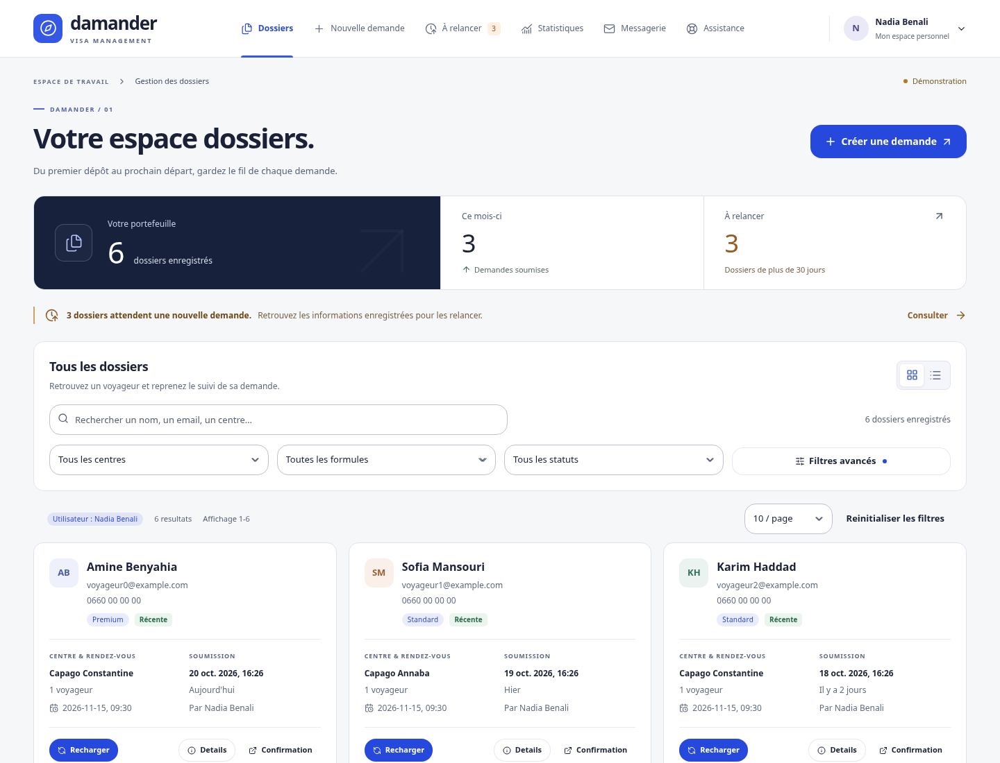
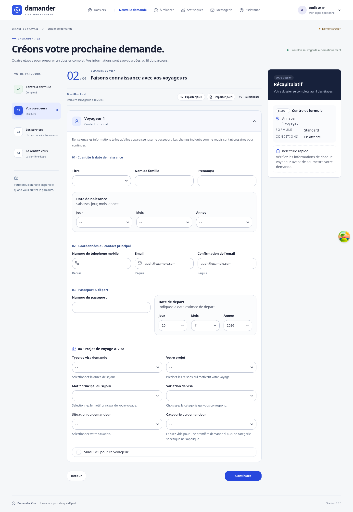

# Interface Windows 0.3.0

These are screenshots of the built interface using local demonstration data. The installed Windows app receives this interface only after building and installing version 0.3.0.

## Dossiers

## Voyageurs

## Windows installer

A push to `codex/ui-redesign-v0.3.0` runs the **Windows 0.3 installer** workflow. When it succeeds, download **Damander-Visa-0.3.0-Windows** from the run's Artifacts section, extract the ZIP and run the installer. The window title and footer identify version 0.3.0. Back up local app data before updating; keep the same application identifier and existing data directory.

See [Windows installation instructions](../../INSTALLATION_WINDOWS.md). A workflow file or screenshot alone does not establish that the native installer built successfully.
