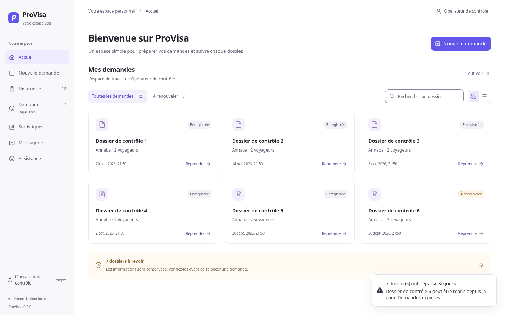

# ProVisa UI redesign

The working application uses a light workspace, a 212px neutral sidebar, restrained lavender accents, compact typography, and shared form controls. The product name is **ProVisa**. The legacy storage keys, Rust names, bundle identifier, booking payloads and draft version remain unchanged for compatibility.

## Screens from the running application

These are Chromium captures of the actual React application in mock mode, not rendered design mockups. Populated screenshots use records created only in an isolated browser context. The application does not seed these records into user history.



| Screen | Actual capture | Implemented behavior |
| --- | --- | --- |
| Accueil | [Home](home.png), [initial empty state](home-empty.png) | Existing requests, applicant/center/contact search, expiration filtering, grid/list views, read-only details and resume actions |
| Configuration | [Configuration](configuration.png) | Centers and formulas from application data, traveler count and terms validation |
| Voyageurs | [Traveler form](travellers.png) | Compact document fields, keyboard traveler tabs, primary traveler, dependent visa options, field validation and preserved values |
| Services | [Services](services.png) | Actual available services and metadata-based premium inclusions; no invented prices |
| Rendez-vous | [Appointment](appointment.png), [waiting list](appointment-queue.png) | Availability/calendar or waiting-list branch, review and existing verification requirements |
| Historique | [History](history.png) | Search, advanced filters, sorting, pagination, read-only details and existing dossier actions |
| Demandes expirées | [Expired requests](expired.png) | Existing records and renewal actions; advanced test option kept available |
| Statistiques | [Statistics](statistics.png) | Indicators and breakdowns calculated from stored records |
| Messagerie | [Mail](mail.png) | Existing desktop Gmail integration; honest desktop requirement in the browser |
| Assistance | [Support](support.png) | Existing working contact links |
| Profil | [Profile dialog](profile.png) | Labels, inline validation, saving/failure feedback, keyboard focus containment, Escape and focus restoration |

## Final refinement

The initial audit found the light shell, home page, wizard, and remaining sections already implemented. This pass preserved them and completed the following gaps:

- Replaced the floating profile disclosure with a dialog, preserving the existing profile persistence API and unsaved edits when the editor closes.
- Added recovery feedback when history cannot load. History, expired requests and statistics no longer present unknown data as empty results. Retry reloads the real records.
- Reduced the stepper to compact circles and labels, keeping actual completed/active state and keyboard-accessible navigation.
- Removed the traveler's large tinted container and repeated guidance. Visa fields retain the same controllers, dependencies, values and validation rules. Required category guidance follows existing visa metadata.
- Corrected French validation, status and fallback copy. Field hints and errors are associated with their controls for assistive technology.
- Strengthened input, select, checkbox and radio boundaries while keeping decorative card borders delicate. Radio indicators are round; checkbox indicators remain square.
- Fixed focus restoration for native confirmation dialogs.

## Verified

- **61 regression tests across 11 files passed**, including profile validation/save failure/retry/focus return, data-loading failures, autosave/navigation, dossier browsing, booking payloads, calendar and existing Gmail behavior.
- ESLint and the production build passed. The build includes TypeScript checking.
- **43 browser states audited with axe-core:** zero reported WCAG 2 A/AA, WCAG 2.1 A/AA or best-practice violations.
- All seven pages checked at **1024×768, 1280×800, 1440×900 and 1920×1080**, with no horizontal document overflow.
- All four wizard stages separately captured and audited at all four sizes. Form actions remain in normal document flow and do not cover fields.
- Browser assertions exercised profile keyboard behavior, invalid-stage blocking, traveler switching/value retention, home search/filter/view modes, read-only details, JSON export/import, reset cancellation/confirmation, waiting-list rendering and recovery from unreadable history.
- JSON reset/import checks preserved the separate history store. No production user data was used or rewritten by the audit.
- Computed wizard control boundary colors were checked against their control backgrounds at every required size, with a minimum 3:1 contrast requirement (160 sampled controls; observed minimum 3.57:1). This supplements axe's text checks; it is not a complete accessibility certification.

The audit still reports incomplete text-contrast checks for some short text, native controls or overlapping elements. Manual screen-reader review and complete visual contrast assessment remain necessary. No new Loom reference image accompanied the repeated text brief, so visual review used the written direction and the actual running ProVisa screens.

## Reproduce the browser checks

Use an isolated mock-mode Vite server. The script refuses to proceed in live mode and never supplies a verification token or submits a live appointment.

```bash
npm ci
VITE_MOCK_MODE=true npm run dev
```

In another terminal, install optional audit tools outside the application dependency tree and supply a Chromium executable:

```bash
npm install --prefix /tmp/provisa-audit-tools --no-save playwright-core axe-core
PROVISA_AUDIT_TOOLS=/tmp/provisa-audit-tools/node_modules \
PROVISA_CHROMIUM_PATH=/usr/bin/chromium \
npm run verify:ui
```

`PROVISA_AUDIT_URL` overrides the default `http://127.0.0.1:1420/`. `PROVISA_AUDIT_OUT` overrides `deliverables/ui-audit`. Audit tooling is optional and is not included in the application bundle.

The output directory contains `after/*.png`, `accessibility.json`, `control-contrast.json`, `browser-results.json` and `exported-draft.json`. Failures exit nonzero and Chromium is closed in a `finally` block. Detailed logs for this cloud run are under `/workspace/provisa-final`.

## Packaging and remaining limits

**No Windows installer was produced or found.** `npm run build:tauri` fails before compilation because the Cargo executable is missing (`cargo metadata`: no such file or directory). This Linux host did not run a native Windows build. The Tauri configuration also references a missing local `.env` as a bundle resource; that pre-existing packaging prerequisite needs resolution on the Windows build machine without committing credentials.

The production frontend output is `dist/index.html` plus `dist/assets/*`. It is not a Windows installer. Existing warnings about a JavaScript chunk larger than 500 kB and outdated Browserslist data remain.

Native windowing, Windows credential encryption, real database connectivity, live Gmail OAuth, native file dialogs, real appointment submission and live reCAPTCHA acceptance remain unverified. Their existing implementations were retained. The browser and unit checks use fixtures or mocks for these integrations.
